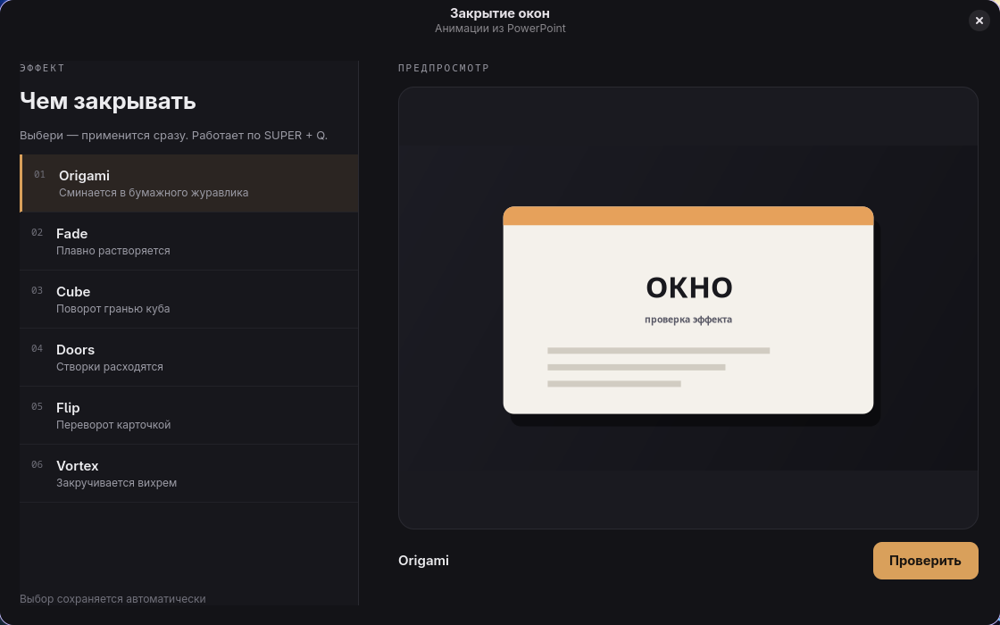

# crane-close

Анимации закрытия окна в стиле переходов **PowerPoint** для Hyprland:
можно выбрать эффект и закрывать окна с ним по `SUPER + Q`.

По умолчанию — **Origami**: скриншот окна сминается в бумажного журавлика,
журавлик машет крыльями и улетает, окно закрывается.

Сделано для **Hyprland + Quickshell** (Wayland). Журавлик — настоящая
3D-модель из 16 бумажных граней: на лицевую сторону проецируется содержимое
окна, изнанка чёрная.

## Эффекты

| Эффект | Что делает |
|---|---|
| **Origami** | Окно сминается в журавлика, он улетает |
| **Fade** | Плавно растворяется |
| **Cube** | Поворачивается гранью куба |
| **Doors** | Створки расходятся в стороны |
| **Flip** | Переворачивается карточкой |
| **Vortex** | Закручивается вихрем в точку |

Все эффекты трёхмерные: страница живёт в 3D-сцене, с перспективой и
глубиной. Origami — журавлик с машущими крыльями, случайной стороной полёта
и размером по окну. Cube, Doors, Flip и Vortex — объёмные превращения
листа, Fade — 3D-растворение. Это стилизованные версии переходов
PowerPoint, а не пиксельная копия.

## Настройки

Отдельная программа:

```sh
crane-settings
```

или из меню приложений — «Анимация закрытия окна».



- Слева список эффектов, справа живой предпросмотр: это настоящая
  3D-анимация оверлея поверх макета окна, а не упрощённая картинка.
- Выбираешь эффект — он сразу сохраняется в `~/.config/crane/config.json`.
- Кнопка **«Проверить»** открывает настоящее окно-образец и закрывает его
  выбранным эффектом.

Интерфейс собран по правилам из набора `stitch-skills`: тёмная нейтральная
база, один акцент, нумерованный список, живые микро-анимации, без лишних
карточек и неона.

## Что нужно

- Hyprland (проверено на 0.57, конфиг на Lua).
- Quickshell 0.3+ с поддержкой Qt Quick 3D.
- Python 3, `grim`.
- GTK4 и PyGObject — только для программы настроек.
- Мониторы с масштабом 1 (при других масштабах скриншот может не совпасть
  по размеру).

## Установка

1. Разложить файлы:

```sh
mkdir -p ~/.config/quickshell ~/.local/bin ~/.local/share/applications
cp -r quickshell ~/.config/quickshell/crane
install -Dm755 bin/crane-close ~/.local/bin/crane-close
install -Dm755 bin/crane-settings ~/.local/bin/crane-settings
install -Dm644 share/applications/crane-settings.desktop ~/.local/share/applications/crane-settings.desktop
```

2. Автозапуск оверлея (в блок `exec-once`):

```lua
local home = os.getenv("HOME")
hl.exec_cmd("qs -n -p " .. home .. "/.config/quickshell/crane -d")
```

3. Закрытие окна на скрипт. **Полный путь обязателен** — в PATH у Hyprland
обычно нет `~/.local/bin`:

```lua
local home = os.getenv("HOME")
create_bind(vars.kbCloseWindow, hl.dsp.exec_cmd(home .. "/.local/bin/crane-close"))
```

4. Отключить анимацию слоя, иначе оверлей будет выезжать сбоку:

```lua
hl.layer_rule({ match = { namespace = "crane" }, no_anim = true })
```

5. Окна настроек и образца — плавающие:

```lua
hl.window_rule({ match = { class = "ru.crane.Settings" }, float = true, center = true })
hl.window_rule({ match = { class = "ru.crane.Preview" }, float = true, center = true })
```

6. Перезагрузить Hyprland и запустить оверлей:

```sh
hyprctl reload
qs -n -p ~/.config/quickshell/crane -d
```

Готово. Выбираешь эффект в `crane-settings`, жмёшь `SUPER + Q`.

## Как это устроено

| Файл | Что делает |
|---|---|
| `quickshell/shell.qml` | корень оверлея, IPC, очередь запросов |
| `quickshell/CraneOverlay.qml` | окно на монитор, эффекты, таймлайн |
| `quickshell/Crane3D.qml` | сборка журавлика из граней, взмахи |
| `quickshell/CraneFacet.qml` | одна грань: лицо и чёрная изнанка |
| `quickshell/facets.js` | 16 граней: точки, UV, глубина, оттенок |
| `bin/crane-close` | скриншот окна, выбор эффекта, IPC, закрытие |
| `bin/crane-settings` | окно настроек и образец для проверки |

Скрипт снимает окно через `grim`, читает эффект из
`~/.config/crane/config.json`, отдаёт всё оверлею по IPC и закрывает окно
по адресу. Оверлей живёт поверх окон, но не ловит мышь и клавиатуру.

Пересобрать грани из SVG:

```sh
cd ~/.config/quickshell/crane
python3 tools/make_facets.py
```

## Ограничения

- Перехватить клик по крестику внутри чужой программы на Wayland нельзя:
  анимация работает только при закрытии через бинд.
- Если оверлей не запущен, окно просто закрывается, без анимации.
- Скриншот снимается с экрана: если окно перекрыто другим окном, в анимации
  окажется то, что видно. Для активного окна это не проблема.

## Лицензии и атрибуция

Журавлик собран по SVG **«Origami - Crane.svg»** с Wikimedia Commons:

- автор: **Binnette**;
- лицензия: **CC BY-SA 3.0**;
- источник: https://commons.wikimedia.org/wiki/File:Origami_-_Crane.svg

`quickshell/assets/crane.svg` и производный `quickshell/facets.js`
распространяются на условиях CC BY-SA 3.0. Подробности — в
[ATTRIBUTION.md](ATTRIBUTION.md).

На остальной код явная лицензия не задана.
